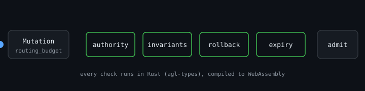

# autogenous

[](https://www.npmjs.com/package/autogenous)

The Autogenous Genome Language (AGL) for JavaScript. It brings the typed mutation admission, scope authority and hard-gate checks of the [Autogenous Runtime](https://github.com/ruvnet/autogenous) to Node.js. The checks are not reimplemented: they are the `agl-types` Rust crate compiled to WebAssembly.



## Install

```sh
npm install autogenous
```

Node.js 20 or newer. No native build: the package ships one `.wasm` file.

## Quickstart

```js
import { admitMutation, scopePolicy, passesHardGates } from 'autogenous';

const parent = {
  hash: 'g0', identity: 'my-agent', constitution: 'c0',
  capability_ceiling: 'governed',
  hard_invariants: [{ name: 'tenant_isolation', holds: true }],
  lineage: [],
};

const mutation = {
  id: 'm1', parent_genome_hash: 'g0',
  scope: 'routing_budget', requested_authority: 'auto_reversible',
  applicability: { workloads: [], environments: [], jurisdictions: [] },
  preserved_invariants: [{ name: 'tenant_isolation', holds: true }],
  rollback_target: 'g0', expires_at: null, signature: null,
};

console.log(admitMutation(mutation, parent, 0));
// { admissible: true }

console.log(admitMutation({ ...mutation, rollback_target: null }, parent, 0).reason);
// no_rollback

console.log(scopePolicy('application_code'));
// { scope: 'application_code', autoPromotable: false, minAuthority: 'governed' }

console.log(passesHardGates({
  task_quality: 1, safety: 0.5, governance: 1, reliability: 1,
  p99_overhead_ms: 1, false_positive_rate: 0, regression_count: 0, rollback_verified: true,
}));
// false: high quality cannot compensate for a safety failure
```

## API

| Export | Rust source | What it decides |
| --- | --- | --- |
| `admitMutation(mutation, parent, now)` | `Mutation::admissible` | Parent match, no constitutional scope, authority within the parent's ceiling and at least the scope's floor, every parent invariant preserved, a rollback target, not expired. Returns `{ admissible, error?, reason? }`. |
| `scopePolicy(scope)` | `MutationScope::auto_promotable`, `min_authority` | Whether a scope can ever auto-promote, and the authority it requires. |
| `passesHardGates(fitness, gates?)` | `FitnessVector::passes_hard_gates` | The hard AND-gate over a fitness vector. `gates` defaults to `DEFAULT_HARD_GATES`. |
| `AUTHORITIES`, `MUTATION_SCOPES`, `DEFAULT_HARD_GATES` | `agl-types` | Ordered enums and the ADR-392 §14 default gates. |

`now` is passed in (unix seconds) so every decision is reproducible. Malformed input throws; inputs over 64 KiB are rejected.

## Used by

- [`@metaharness/autogenous`](https://github.com/ruvnet/metaharness/tree/main/packages/autogenous) runs every flywheel candidate through `admitMutation` before it can be promoted.

## License

MIT. Homepage: [ruv.io](https://ruv.io).
